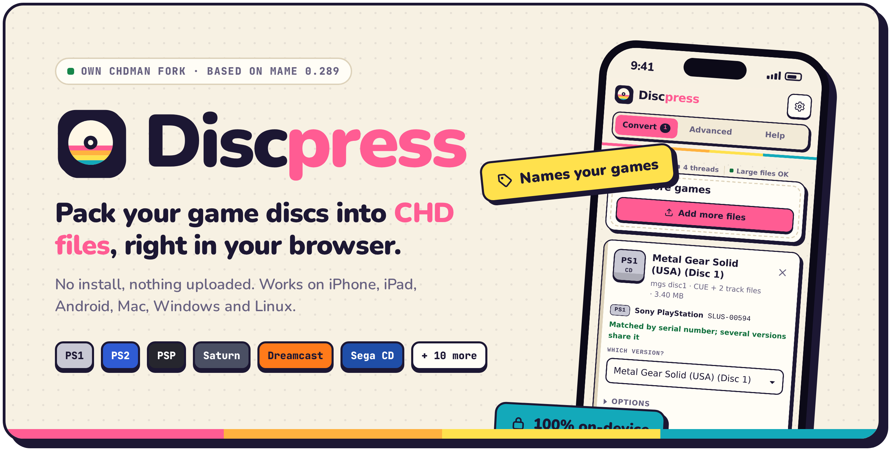

<picture>
  <source media="(prefers-color-scheme: dark)" srcset="https://raw.githubusercontent.com/PowerBeef/discpress/v1.8.2/docs/brand/hero-dark.png">
  
</picture>

**Discpress 1.8.2 says what it does**: fixes from a check of every page of its documentation against the app, and the few bugs that check turned up.

## Get it

- **[⬇ discpress.html](https://github.com/PowerBeef/discpress/releases/download/v1.8.2/discpress.html)** (about 3 MB): the whole app in one file you keep. If you use the downloaded file, download it again for this version.
- **[🌐 powerbeef.github.io/discpress](https://powerbeef.github.io/discpress/)**: nothing to download, and the way to convert big games on iPhone and iPad. It updates itself.

## Fixes

- **iPhone and iPad, "Save all to Files":** when the share sheet can't read the files, they are now downloaded, with a message. Before, nothing happened. Saving one result already did this.
- **A damaged CHD can no longer crash the engine.** A CHD whose map makes a hunk a copy of itself, or gives a block an impossible length, now stops with "Invalid data" when you extract or verify it. chdman 0.289 crashes on such files.
- **The Zstd warning for PlayStation games had the wrong year.** SwanStation reads Zstd CHDs since the end of March 2026, not 2024: the card now says "builds from before April 2026".
- **The engine's status** reads "Engine ready (without SIMD)" in browsers without WebAssembly SIMD. It said "(compatibility mode)", which since 1.8.1 is the name of a setting.
- **For PC discs,** the compression hint says to choose *No compression* for DOSBox Pure, instead of following "Works in every emulator" with the exception.

## Help and README

- The Redump database holds **over 33,000 discs**, not "over 31,000".
- Help lists everything a CHD can be extracted to (cdrdao `.toc`, a hard disk's `.img` and a LaserDisc's `.avi` too), PC-98 and CloneCD images among the inputs, and where the Scrolling setting is.
- The README no longer says compression uses all your CPU cores (it uses as many as make it faster), or that chdman 0.289 stores CD+G discs wrong (it refuses them).

CHDs are the same as 1.8.1's, byte for byte the same as chdman 0.289's with the default settings.

---

Discpress is free and open source under the BSD 3-Clause license. See the [README](https://github.com/PowerBeef/discpress#readme) for help and the FAQ.
