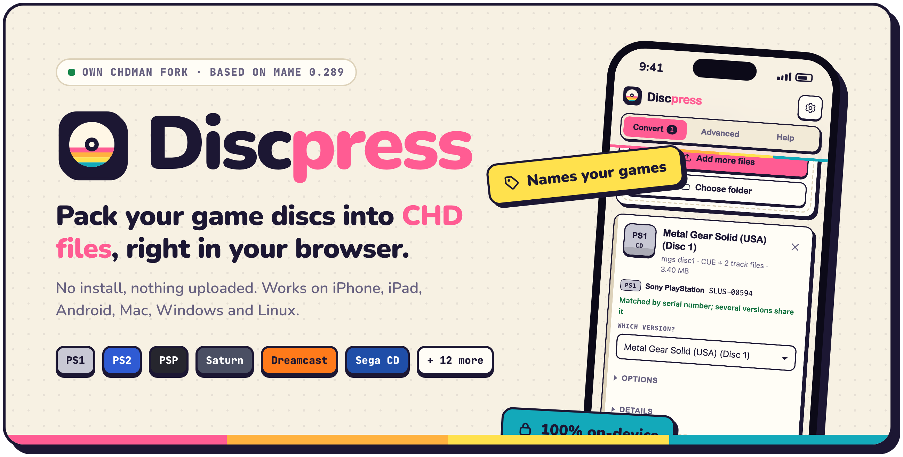

<picture>
  <source media="(prefers-color-scheme: dark)" srcset="https://raw.githubusercontent.com/PowerBeef/discpress/v1.9.0/docs/brand/hero-dark.png">
  
</picture>

**Discpress 1.9.0 is hardened from the engine up**: a smaller download, lower memory use, deeper protection against damaged or crafted CHDs and disc descriptors, sharper emulator warnings, and a steadier offline web app.

## Get it

- **[⬇ discpress.html](https://github.com/PowerBeef/discpress/releases/download/v1.9.0/discpress.html)** (about 3 MB): the whole app in one file you keep. If you use the downloaded file, download it again for this version.
- **[🌐 powerbeef.github.io/discpress](https://powerbeef.github.io/discpress/)**: nothing to download, and the way to convert big games on iPhone and iPad. It updates itself.

## Lighter and faster

- **Smaller single-file download (~220 KB lighter):** the source-change diff in Help → About is now gzip-packed and unpacked on demand when you open Help, trimming `dist/discpress.html` without leaving anything out.
- **~30 MB less memory per worker:** the browser engine now allocates only the single codec compressor group it uses instead of sixteen, and eliminates an unnecessary buffer copy in helper workers.
- **Native C++20 thread pool:** for native `chdman` builds, a standard C++20 worker pool replaces MAME's `osd_work_queue` (no 16-thread cap, `-np 1` runs inline without busy-waiting, and worker threads join cleanly on early errors).

## Safer on damaged or malformed inputs

- **Hostile or corrupted CHDs:** cyclic metadata chains are rejected with cycle detection; crafted CHD headers and maps (zero sizes, out-of-bounds maps, unused codec slots, oversized hunks) and truncated compressed blocks stop cleanly with an error instead of crashing or reading out of bounds. CHDs with hunks larger than 8 MB now verify and extract cleanly.
- **Malformed disc descriptors and compressed ISOs:** stricter 64-bit bounds checks for WAV headers and Nero `.nrg` images, sequential track checks in cue sheets, overlap/padding checks in `.gdi` files, EAC split-pregap handling across differing sector sizes, bounded LZ4 loops on damaged `.zso` files, and a guard preventing `extractcd --redump` from splitting TOSEC GD-ROM pregaps across mismatched sector sizes.
- **Worker and storage resilience:** streaming results into a chosen folder dynamically pins up to 64 MB of the CHD v5 map for large uncompressed CHDs; cancellations, helper-worker failures, and storage errors clean up reliably without hanging pending jobs.

## Better emulator notes and identification

- **PC Engine CD and *Keep the cue sheet*:** PC Engine CD games now leave out the extra `CUES` tag alongside Saturn and Sega CD, because jgenesis rejects unknown metadata tags on both Sega CD and PC Engine CD.
- **Sharper emulator warnings:** Dreamcast and NAOMI `MODE2_FORM_MIX` tracks now show the Flycast warning alongside `MODE2/2048` and `MODE2/2324`; cue-sheet `PREGAP` / `POSTGAP` warnings also name **jgenesis** (Sega CD, PC Engine CD) and **PCSX ReARMed** (PlayStation); Nero `.nrg` images now feed into disc-layout quirk checks.
- **DAT verification and LibCrypt:** multi-track DAT matching uses exact 1-to-1 track multiset matching and cleanly restores previous names when DATs are removed; all **197** PAL PlayStation LibCrypt serials in `db/facts/libcrypt.tsv` are active and matched against the built-in database.

## Steadier web app & accessibility

- **Offline service worker (`powerbeef.github.io/discpress`):** caches only same-origin non-redirected `200` responses, passes redirects through unchanged, scopes error-page fallbacks strictly to app navigations, avoids cloning ~3 MB responses after timeout fallback, and prunes stale cache entries on activation. The web app manifest now includes `"id": "./"`.
- **Advanced tab, accessibility & notices:** fixed `copy` and CLI input/output path routing in the Advanced tab; improved dark-theme error toast contrast, Windows High Contrast (`forced-colors`), tablist/dialog ARIA, and verbatim third-party license notices in Help → About.

CHDs are the same as 1.8.2's, byte for byte the same as chdman 0.289's with the default settings.

---

Discpress is free and open source under the BSD 3-Clause license. See the [README](https://github.com/PowerBeef/discpress#readme) for help and the FAQ.
