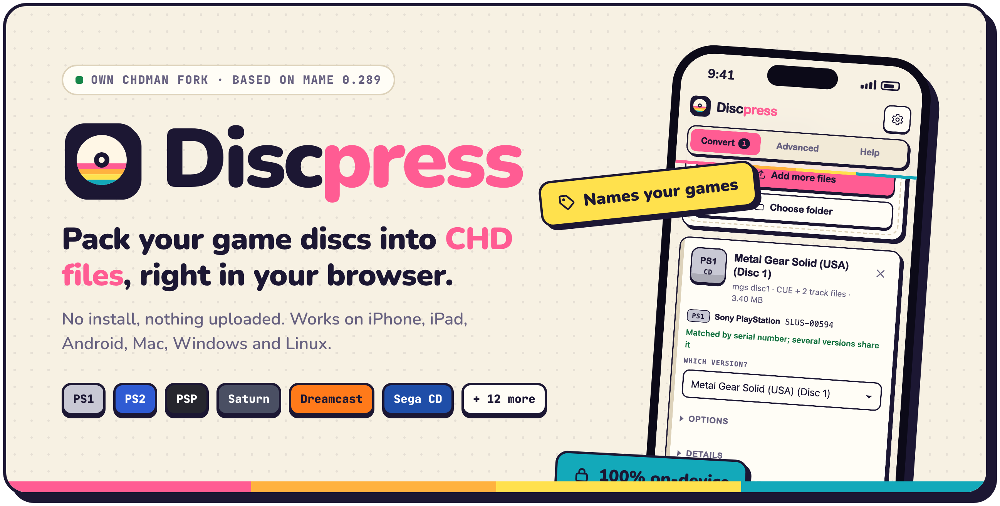

<picture>
  <source media="(prefers-color-scheme: dark)" srcset="https://raw.githubusercontent.com/PowerBeef/discpress/v2.0.0/docs/brand/hero-dark.png">
  
</picture>

**Discpress 2.0.0 is a full-stack overhaul from engine to UI**: faster WebAssembly SIMD compression, Target Environment profiles tailored to your emulator or handheld, crash-resumable storage, a 12-check CHD Library Health Auditor, reversible layout repairs, broad new archive/disc/audio format support, and hardware-ready CSO/ZSO and Original Xbox XISO outputs.

## Get it

- **[⬇ discpress.html](https://github.com/PowerBeef/discpress/releases/download/v2.0.0/discpress.html)** (about 3.2 MB): the whole app in one file you keep. If you use the downloaded file, download it again for this version.
- **[🌐 powerbeef.github.io/discpress](https://powerbeef.github.io/discpress/)**: nothing to download, and the way to convert big games on iPhone and iPad. It updates itself.

## Target profiles, CHD Health Auditor & Emulator Reliability

- **Target Environment selector:** pick **Universal** (default, byte-identical to MAME 0.289), **Fast Universal**, **ES-DE / PC**, **Handheld**, **MiSTer FPGA**, or **Legacy** directly in the top status bar (and mirrored in Settings) to set the right codec, hunk size, and compatibility guards per console automatically.
- **12-check CHD Library Health Auditor:** dropping existing `.chd` files audits them for v3/v4 formats, wrong CD/DVD mode, oversized PSP hunks, incompatible Zstd/MiSTer codecs, disallowed `CUES` tags on Saturn/Sega CD/PCE-CD, and more — offering **1-click `copy` repairs** and 2-step lossless rebuilds.
- **Reversible Tier X disc layout repairs:** opt-in `--sessions` (`CHSE`), reversible `--trailer` (`DPRC0001`, restored cleanly by `extractcd --redump`), and `--stripmeta` flags for discs that emulators otherwise misread, marked with clear non-color-only tier badges.
- **Smarter organization & multi-disc sets:** organize outputs by Flat, Console, or Tree folder layouts when saving to a folder, generate `.m3u` playlists for Flat, **ES-DE** (`.m3u/` folder), **Handheld** (`.hidden`/`.discs`), or **MinUI**, get pre-flight overwrite conflict prompts, and see batch space, time, and storage quota estimates before starting.
- **Expanded console & game detection:** columnar binary `DPDB v2` Redump index, Saturn RAM/backup cartridge facts (`db/facts/saturn-cart.tsv`), 10 additional recognized Redump systems, improved `.sub`/`.mdf` → `.sbi` LibCrypt extraction, and PlayStation/PS2/PSP/Dreamcast/Saturn/PCE-CD quirk refinements.

## Faster, lighter & crash-resumable

- **WASM SIMD128 & 64-bit bitstreams:** bit-exact SIMD acceleration for FLAC predictors and QLP residuals, shared per-hunk CD frame/ECC preparation (`cd_prep_cache`), 64-bit FLAC bitstreams, persistent warm `WorkerPool`, and worker-side OPFS `.zip` unpacking.
- **Better presets & adaptive codec planning:** upgraded `--codecplan` with entropy fallback and a 200 ns PCM probe (skips FLAC on pure data while catching embedded PCM), dynamic 8 MiB hunk buffers preserving Tier-R output, and a new **Smaller still** archival preset (`--ultra` LZMA/FLAC and Zstd level 19).
- **Single-pass `verify --redump` & lower memory:** verifies CHD integrity and Redump/DAT track CRC-32s in one pass, releases DVD-9 working memory early, uses 32-byte packed hash entries, and fixes legacy `#16644` partial-sample FLAC EOS decoding.
- **Crash-resumable OPFS checkpoints & mobile hardening:** long conversions checkpoint cleanly to OPFS so reloads or mobile pauses can resume instead of starting over, with persistent directory handles, **Save & Free** storage reclamation, ETA suspension, and `PressureObserver`/battery-aware checkpointing.

## New formats & hardware-ready outputs

- **Audio track cues & GOG `.ins`:** built-in WebAssembly decoding for `.flac`, extended/RF64 `.wav` (24-bit, float, `WAVE_FORMAT_EXTENSIBLE`), `.aiff`/`.aifc`, `.ogg` (Vorbis), and gapless `.mp3`, with mono→stereo conversion, resampling, and explicit `lossy-audio` / `resampled-audio` warnings.
- **Streaming `.7z` archives:** unpack `.7z` archives (LZMA, LZMA2, Deflate, BCJ, Delta, Copy) directly inside the worker via the Public Domain LZMA SDK.
- **Alcohol 120% `.mds`/`.mdf` (v1.x), DiscJuggler `.cdi` & CD+G:** direct CD/DVD `.mds`/`.mdf` conversion (including PS1 `+96B` interleaved Q `.sbi` extraction and v2 refusal), `.cdi` v2/v3/v3.5 (1-session CHD, multi-session `.cue`/`.bin` extraction, and guarded Flycast 2.8+ Tier-X CHD), and guarded `TRACK nn CDG` / CloneCD `.ccd`/`.sub` `RW_RAW` subcode support.
- **CSO v1 / CSO v2 / ZSO (`--block=2048`) writer:** convert PSP or PS2 ISOs, CSO/ZSO files, or existing DVD CHDs directly into hardware-compatible CSO/ZSO for real PSP CFW, PS Vita Adrenaline, and PS2 OPL.
- **Original Xbox scrubbed XISO (`.xiso.iso`) repacker:** clean-room pure-JS scrubber turns 7.28 GB Redump Xbox ISOs into compact `xemu`-bootable XISOs while preserving XDVDFS AVL trees and timestamps.

With the default **Universal** target and *Smallest* compression, CHD files remain byte for byte identical to MAME 0.289 `chdman`.

---

Discpress is free and open source under the BSD 3-Clause license. See the [README](https://github.com/PowerBeef/discpress#readme) for help and the FAQ.
