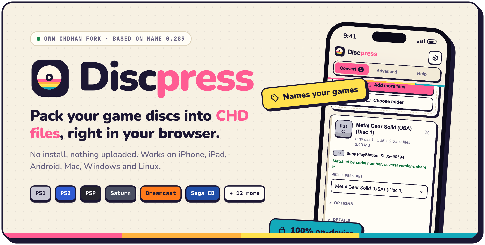
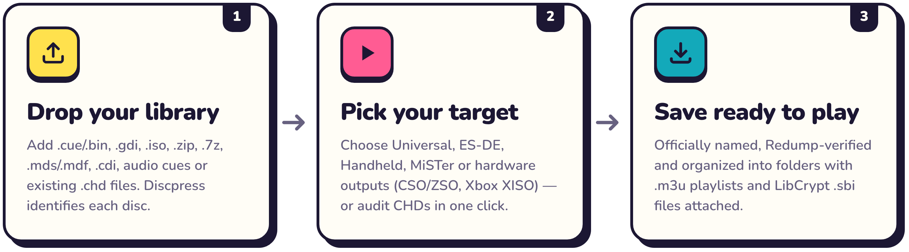
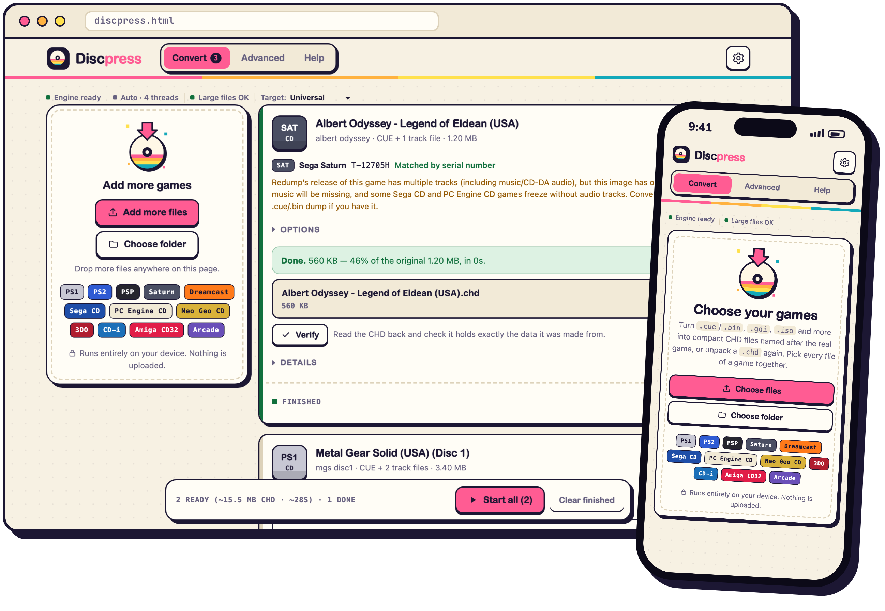
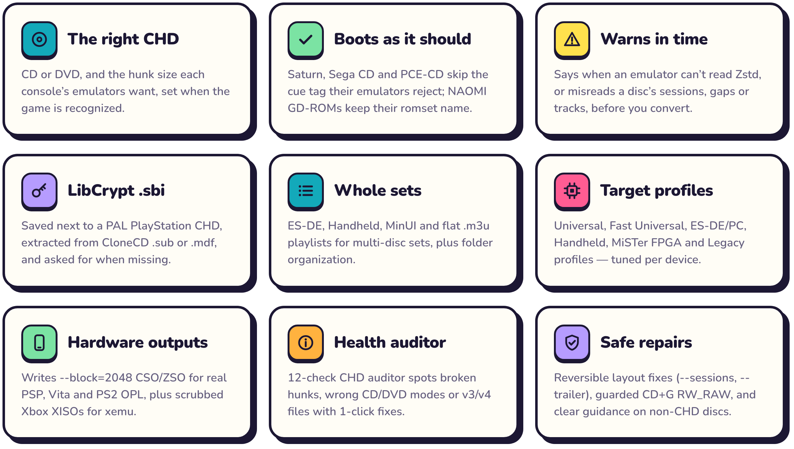
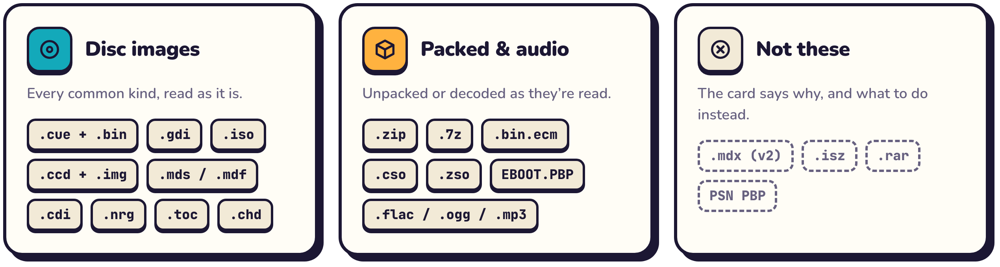
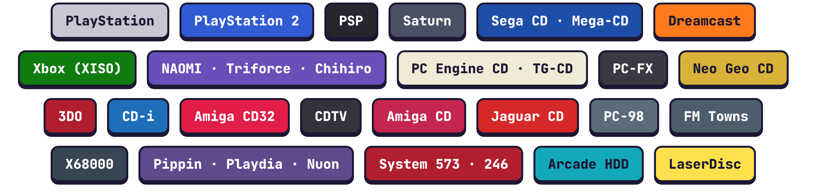
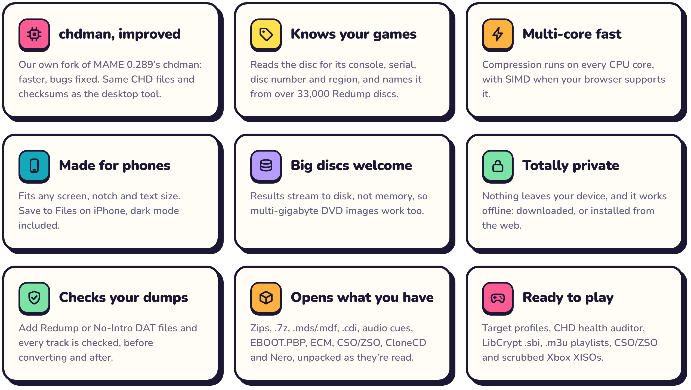
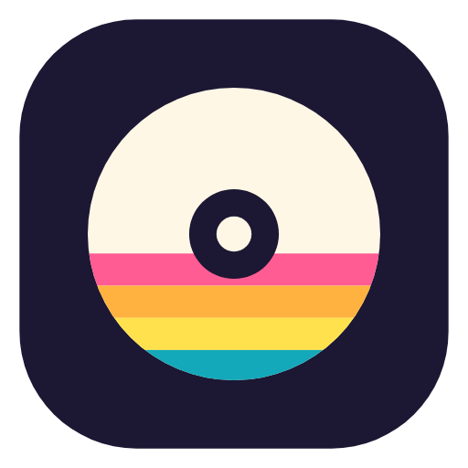

<p align="center">
  <picture>
    <source media="(max-width: 600px) and (prefers-color-scheme: dark)" srcset="docs/brand/hero-mobile-dark.png">
    <source media="(max-width: 600px)" srcset="docs/brand/hero-mobile-light.png">
    <source media="(prefers-color-scheme: dark)" srcset="docs/brand/hero-dark.png">
    
  </picture>
</p>

<p align="center">
  <a href="https://github.com/PowerBeef/discpress/releases/latest/download/discpress.html">
    <picture>
      <source media="(prefers-color-scheme: dark)" srcset="docs/brand/download-dark.png">
      
    </picture>
  </a>
  &nbsp;&nbsp;
  <a href="https://powerbeef.github.io/discpress/">
    <picture>
      <source media="(prefers-color-scheme: dark)" srcset="docs/brand/open-dark.png">
      
    </picture>
  </a>
</p>

<p align="center">
  <a href="https://github.com/PowerBeef/discpress/releases/latest"></a>
  <a href="https://github.com/PowerBeef/discpress/actions/workflows/ci.yml"></a>
  <a href="LICENSE"></a>
  <br><br>
  <b>Free &amp; open source</b> &nbsp;·&nbsp; <b>Zero install</b> &nbsp;·&nbsp; <b>100% offline</b> &nbsp;·&nbsp; <b>Phone, tablet &amp; desktop</b>
  <br><br>
  <a href="#what-discpress-does">Overview</a> &nbsp;·&nbsp;
  <a href="#target-profiles">Target profiles</a> &nbsp;·&nbsp;
  <a href="#audit-and-repair-your-library">Library auditor</a> &nbsp;·&nbsp;
  <a href="#formats-and-hardware-outputs">Formats &amp; hardware</a> &nbsp;·&nbsp;
  <a href="#supported-systems">Systems</a> &nbsp;·&nbsp;
  <a href="#get-started">Get started</a> &nbsp;·&nbsp;
  <a href="#faq">FAQ</a> &nbsp;·&nbsp;
  <a href="#under-the-hood">Under the hood</a>
</p>

> [!TIP]
> **New in 2.0:** Target Environment profiles (Universal, Fast Universal, ES-DE/PC, Handheld, MiSTer FPGA, Legacy), crash-resumable OPFS checkpoints, a 12-check CHD Library Health Auditor with 1-click fixes, reversible Tier X layout repairs (`--sessions`, `--trailer`, `--stripmeta`), streaming `.7z` archives, Alcohol 120% `.mds`/`.mdf`, DiscJuggler `.cdi`, built-in audio track decoding (FLAC, extended WAV/RF64, AIFF, Ogg Vorbis, MP3, GOG `.ins`), `--block=2048` CSO/ZSO output for real PSP/Vita/PS2 OPL hardware, and Original Xbox scrubbed XISOs (`.xiso.iso`) for `xemu`. [Read the v2.0.1 release notes](https://github.com/PowerBeef/discpress/releases/tag/v2.0.1).


## What Discpress does

Managing a retro disc collection usually takes half a dozen command-line utilities, manual batch scripts, separate unzip tools, audio converters, DAT managers, and wiki pages full of per-emulator caveats.

**Discpress puts the entire workflow into one self-contained HTML file** that runs locally in your browser on desktop, iPhone, iPad, and Android — nothing installed, nothing uploaded. Under the hood it combines a hardened, WebAssembly SIMD128-accelerated fork of MAME 0.289's `chdman` with native archive unpackers, disc/audio decoders, a built-in 33,000+ disc Redump database, a CHD health auditor, and real-hardware format writers:

| Pillar | What it replaces |
|---|---|
| **Convert &amp; unpack** | Turns `.cue`/`.bin`, `.gdi`, `.iso`, `.zip`, `.7z`, Alcohol `.mds`/`.mdf`, DiscJuggler `.cdi`, CloneCD `.ccd`/`.sub`, Nero `.nrg`, `.toc`, ECM, CSO/ZSO, `EBOOT.PBP`, and audio-track cues (`.flac`/`.wav`/`.aiff`/`.ogg`/`.mp3`, GOG `.ins`) into standard CHD v5 — or extracts CHDs back to exact Redump dumps. |
| **Hardware formats** | Writes `--block=2048` **CSO v1 / CSO v2 / ZSO** directly (from ISOs or existing DVD CHDs) for real PSP CFW, PS Vita Adrenaline, and PS2 OPL; scrubs 7.28 GB Redump **Original Xbox** `.iso` dumps into compact `xemu`-bootable `.xiso.iso` images in seconds. |
| **Identify &amp; organize** | Reads disc boot headers (even inside CHDs, PBPs, ECMs, `.mds`, and `.cdi`) to name outputs from the built-in **Redump database (33,312 discs)**, verifies every track against your own Redump/No-Intro DATs in a single pass, pairs/extracts PAL PlayStation **LibCrypt `.sbi`** files, and writes **Flat / Console / Tree** folders and **ES-DE / Handheld / MinUI** `.m3u` playlists. |
| **Audit &amp; repair** | Drop an existing CHD library to run a **12-check health audit** (v3/v4 upgrades, broken GD-ROM offsets, wrong CD/DVD mode, oversized PSP/&gt;512 KB hunks, incompatible Zstd codecs, disallowed `CUES` tags, missing LibCrypt `.sbi`) with **1-click lossless `copy` fixes**, 2-step rebuilds, single-pass **Verify**, and reversible layout repairs. |

<p align="center">
  <picture>
    <source media="(max-width: 600px) and (prefers-color-scheme: dark)" srcset="docs/brand/steps-mobile-dark.png">
    <source media="(max-width: 600px)" srcset="docs/brand/steps-mobile-light.png">
    <source media="(prefers-color-scheme: dark)" srcset="docs/brand/steps-dark.png">
    
  </picture>
</p>

<br>

<p align="center">
  <picture>
    <source media="(prefers-color-scheme: dark)" srcset="docs/brand/showcase-dark.png">
    
  </picture>
</p>

## Target profiles

Every emulator and device has its own quirks — hunk sizes, Zstd support, metadata tag limits, multi-disc `.m3u` layouts, and CD-vs-DVD rules. Pick where you play directly in the top bar (or Settings) and Discpress sets every disc up cleanly before you press Start:

| Profile | Best for | Compression & layout | Compatibility contract |
|---|---|---|---|
| **Universal** *(default)* | Sharing, archival & running on every emulator | Standard MAME 0.289 codecs (`cdlz`/`cdzl`/`cdfl`, `lzma`/`zlib`/`huff`/`flac`), console-accurate hunk sizes (`-hs 2048` for PSP) | **Tier R** — byte-identical to Linux MAME 0.289 `chdman` |
| **Fast Universal** | Large batch conversions with full compatibility | Adaptive `--codecplan` (entropy fallback + 200 ns PCM probe) + `libdeflate` | **Tier C** — ~1.5–1.7× faster, ≤0.3% size diff, identical checksums |
| **ES-DE / PC** | EmulationStation-DE, RetroDECK, RetroArch, DuckStation, PCSX2, PPSSPP, Flycast | Fast Universal codecs (`--codecplan` + `libdeflate`), keeps cue sheets where safe, ES-DE `<Game>.m3u/` directory playlists, and reversible layout repairs | **Tier C / Tier X** — fast creation with standard codecs compatible across modern emulators |
| **Handheld** | Steam Deck, Retroid, Odin, Anbernic, OnionOS / muOS / Knulli / Batocera / Android | Fast Universal codecs (`--codecplan` + `libdeflate`), PS2 DVDs as CD CHDs (NetherSX2/AetherSX2), Handheld (`_discs/`) playlists, and reversible layout repairs | Broad ARM/Android/Linux handheld compatibility without dot-prefixed hidden folders |
| **MiSTer FPGA** | MiSTer PSX, Saturn, MegaCD, TurboGrafx-16 CD, Neo Geo CD cores | `cdzs,cdfl` (`--zstd-level 19`) in 4-sector (9,792-byte) hunks + layout repairs; auto-falls back to **Fast Universal** on systems without a MiSTer CD core or Sega CD 32X | Tuned for MiSTer CD cores; warns on consoles without a MiSTer core |
| **Legacy** | AetherSX2, NetherSX2, pre-April-2023 PCSX2, DOSBox Pure, older libchdr builds | Standard MAME 0.289 codecs, PS2 DVDs written as CD CHDs, uncompressed PC CDs (`-c none`), and reversible layout repairs | Warns on Zstd across every system |

<p align="center">
  <picture>
    <source media="(max-width: 600px) and (prefers-color-scheme: dark)" srcset="docs/brand/emulators-mobile-dark.png">
    <source media="(max-width: 600px)" srcset="docs/brand/emulators-mobile-light.png">
    <source media="(prefers-color-scheme: dark)" srcset="docs/brand/emulators-dark.png">
    
  </picture>
</p>

<details>
<summary><b>Per-console rules, companion files &amp; warnings reference</b></summary>
<br>

**Automatic per-console handling**

| System / scenario | What Discpress does |
|---|---|
| **PSP** | Writes DVD CHD with 2,048-byte hunks (PPSSPP), or `--block=2048` CSO v1/v2 / ZSO for real PSP CFW and PS Vita Adrenaline |
| **PlayStation 2** | Detects CD vs DVD from the disc's filesystem (or writes `--block=2048` ZSO/CSO for PS2 OPL); **Handheld** and **Legacy** profiles write PS2 DVDs as CD CHDs for AetherSX2/NetherSX2 |
| **Original Xbox** | Defaults to clean-room scrubbed XISO (`.xiso.iso`) for `xemu`, preserving XDVDFS AVL trees and `FILETIME` |
| **PlayStation (PAL LibCrypt)** | Pairs `.sbi`/`.lsd`, extracts `.sbi` directly from CloneCD/redumper `.sub`/`.subcode` or Alcohol `.mdf` (`+96B` interleaved Q), names it next to the CHD, and flags any of the 197 protected serials missing one |
| **Saturn, Sega CD &amp; PC Engine CD** | Strips optional `CUES` metadata tags even when *Keep the cue sheet* is on (Kronos, Yabause, and jgenesis reject unknown metadata tags); displays mandatory Saturn expansion cartridge requirements — ROM, MPEG Video CD, 1 MB RAM, and 4 MB RAM (`db/facts/saturn-cart.tsv`) |
| **Dreamcast &amp; NAOMI** | Stores GD-ROMs properly from `.gdi` or Redump `.cue`/`.bin`; preserves NAOMI romset filenames (`gdl-xxxx` / `gds-xxxx`); warns on `MODE2/2048`, `MODE2/2324`, `MODE2_FORM_MIX`, and pregaps that break Flycast |
| **Multi-disc sets** | Tracks missing discs across the set and generates `.m3u` playlists in **Flat**, **ES-DE** (`Game.m3u/` folder), **Handheld** (`_discs/` subfolder), or **MinUI** layouts, alongside **Flat**, **Console**, or **Tree** output folders |

**Emulator warnings shown before you convert**

- **Zstd &amp; MiSTer compatibility:** names the exact emulators per console that can't read Zstd (Kronos, Yabause, Yaba Sanshiro 2, BlastEm, Beetle SuperGrafx, Opera, WinUAE, Gamma (iOS), older SwanStation, AetherSX2/NetherSX2, Flycast &lt; 2.3, Redream, Demul, older Beetle PC-FX) and warns when MiSTer has no core for a system.
- **Cue &amp; disc layout traps:** flags 2,048-byte PS1 rips (missing XA audio/FMVs, rejected by Beetle PSX), multi-session discs (CD-Extra, MIL-CD, Jaguar CD), `PREGAP`/`POSTGAP` offset issues (Saturn, PCE-CD, PC-FX, PS1, Sega CD, NeoCD), PS2 CD music tracks (PCSX2 track-1 limit), Sega CD ≥80 min (PicoDrive) / mixed-track (Genesis Plus GX) / late-audio (BlastEm) layouts, Neo Geo CD Mode 2 tracks, lossy/resampled audio tracks, and CD+G `RW_RAW` subcode caveats (Beetle PCE).
- **Non-CHD media:** identifies GameCube &amp; Wii discs (pointing to Dolphin's right-click **Convert File → RVZ**), PS3, Xbox 360, UMD Video, Video CD, DVD-Video, and Blu-ray clearly so you never waste time converting discs an emulator won't load.

</details>

## Audit and repair your library

Already have a folder full of `.chd` files collected over the years? Drop them straight onto Discpress — you don't have to extract anything to inspect, verify, or fix them:

- **12-check CHD Library Health Auditor:** inspects every dropped `.chd`'s headers, metadata, and track layout against your active Target profile and console rules, flagging legacy v3/v4 CHDs, broken GD-ROM Track 3 offsets and Flycast pregap/subcode traps, CD-only discs packed as DVDs, PS2 CD/DVD target mismatches, PSP CHDs with oversized hunks (or &gt;512 KB hunks), incompatible Zstd codecs, disallowed `CUES`/extra metadata tags on Saturn/Sega CD/PCE-CD, cooked 2,048-byte PS1 CHDs, compressed PC CHDs on Legacy, and missing PAL PS1 LibCrypt `.sbi` files (run **Verify** to detect corrupted hunks).
- **1-click lossless fixes:** metadata-only and recompression issues (such as upgrading v3/v4 → v5, stripping disallowed `CUES` via `--stripmeta`, or re-packing codecs/hunks) fix in **1 click via `copy`**; structural mismatches (such as CD ↔ DVD mode) offer guided 2-step lossless rebuilds.
- **Single-pass `verify --redump`:** checks CHD integrity and computes Redump/DAT per-track CRC-32s simultaneously without writing extracted `.bin` files to disk.
- **Reversible Tier X layout repairs:** opt-in `--sessions` (`CHSE` session metadata) and reversible `--trailer` (`DPRC0001`, stripped cleanly by `extractcd --redump`) repair multi-session and gap-sensitive layouts without breaking round-trip Redump restoration.
- **Batch safety:** pre-flight overwrite conflict dialog (`Cancel`, `Skip existing`, `Replace all`), batch size/time/storage-quota estimates before `Start all`, and **Rename** for fixing existing CHD filenames from Redump or your DATs.

## Formats and hardware outputs

<p align="center">
  <picture>
    <source media="(max-width: 600px) and (prefers-color-scheme: dark)" srcset="docs/brand/formats-mobile-dark.png">
    <source media="(max-width: 600px)" srcset="docs/brand/formats-mobile-light.png">
    <source media="(prefers-color-scheme: dark)" srcset="docs/brand/formats-dark.png">
    
  </picture>
</p>

### What goes in, what comes out

| Source format | How Discpress handles it | Output choices |
|---|---|---|
| **`.cue` + `.bin`**, **`.gdi`**, **`.toc`**, **`.nrg`**, **`.iso`** | Read directly from disk (no copy into RAM); fixes encodings, case mismatches, macOS accents, and lone-`.bin` cues | CD / GD-ROM / DVD **CHD v5**; PSP/PS2 **CSO v1 / CSO v2 / ZSO** (`--block=2048`); Original Xbox scrubbed **`.xiso.iso`** |
| **Audio cues &amp; GOG `.ins`** (`.flac`, `.wav`/RF64, `.aiff`, `.ogg`, `.mp3`) | Decoded on-the-fly in WebAssembly (`FLAC`, 24-bit/float/extensible `WAV`, `AIFF`, `stb_vorbis`, gapless `minimp3`), with `lossy-audio`/`resampled-audio` warnings | CD **CHD v5** (lossless tracks match raw Red Book PCM byte for byte) |
| **`.zip` (zip64) &amp; `.7z`** | Unpacked in the worker (stored zips read in place; LZMA/LZMA2/Deflate/BCJ/Delta `.7z` streamed via Public Domain LZMA SDK) | Same as the disc image inside |
| **Alcohol 120% v1.x (`.mds` + `.mdf`)** | CD tracks via stride virtual store (plus PS1 `+96B` interleaved Q `.sbi` extraction); DVD `.mdf` direct pass-through; v2 `.mdx`/`.mds` clearly refused | CD / DVD **CHD v5** (+ `.sbi`) |
| **DiscJuggler (`.cdi` v2/v3/v3.5)** | 1-session `.cdi` converts directly to CHD; multi-session Dreamcast MIL-CD defaults to `.cue` + `.bin` extraction with optional guarded Flycast 2.8+ Tier-X CHD | CD **CHD v5** or extracted **`.cue` + `.bin`** |
| **CloneCD (`.ccd` + `.img` + `.sub`) &amp; CD+G** | Extracts LibCrypt `.sbi` from `.sub` for PAL PS1; supports `TRACK nn CDG` and opt-in `.sub` → `RW_RAW` subcode preservation | CD **CHD v5** (+ `.sbi`) |
| **`.bin.ecm`, `.cso`, `.zso`, popstation `EBOOT.PBP`** | Decompressed block by block as they are read (multi-disc PBPs split into one card per disc) | CD / DVD **CHD v5**, or re-packed **CSO / ZSO** |
| **Existing `.chd`** | Audited (12 health checks), verified in one pass, renamed, or extracted losslessly | Redump **`.cue`/`.bin`**, **`.gdi`**, **`.toc`**, **`.iso`**, **`.img`**, **`.avi`**, **CSO / ZSO** (from DVD CHD), or repaired **`.chd`** |
| **Arcade hard disks &amp; LaserDisc** (`.img`, `.hdd`, `.avi`) | Full `createhd` / `extracthd` / `createld` / `extractld` support + every `chdman` command in the **Advanced** tab | Hard disk / LaserDisc **CHD v5** (and back) |

<details>
<summary><b>Formats intentionally refused (and what to use instead)</b></summary>
<br>

| Format | What to do instead |
|---|---|
| **Daemon Tools v2 `.mdx` / `.mds` v2** | Convert to `.cue`/`.bin` or `.iso` first (Alcohol 120% v1.x `.mds`/`.mdf` works directly) |
| **UltraISO `.isz`** | Convert to `.iso` with UltraISO first |
| **PC-98 `.hdi` / `.nhd` &amp; Virtual hard disk `.vhd`** | Use `.hdi`/`.nhd` directly in Neko Project II or `.vhd` in MiSTer ao486 / 86Box, or strip their headers / convert to a raw `.img` first |
| **`.rar`** &amp; password-encrypted `.zip`/`.7z` | Unpack first (standard `.zip` and `.7z` archives work directly) |
| **Encrypted PlayStation Store `EBOOT.PBP`** | Use a disc dump or popstation PBP |
| **GameCube / Wii `.iso`** | In Dolphin, right-click the game → **Convert File → RVZ** |

</details>

## Supported systems

Over **30 consoles, home computers, and arcade systems** recognized from disc headers and backed by **33,312 Redump database entries** (plus unlimited custom Redump and No-Intro DAT files):

<p align="center">
  <picture>
    <source media="(max-width: 600px) and (prefers-color-scheme: dark)" srcset="docs/brand/systems-mobile-dark.png">
    <source media="(max-width: 600px)" srcset="docs/brand/systems-mobile-light.png">
    <source media="(prefers-color-scheme: dark)" srcset="docs/brand/systems-dark.png">
    
  </picture>
</p>

## Built like a native app — still one offline file

<p align="center">
  <picture>
    <source media="(max-width: 600px) and (prefers-color-scheme: dark)" srcset="docs/brand/features-mobile-dark.png">
    <source media="(max-width: 600px)" srcset="docs/brand/features-mobile-light.png">
    <source media="(prefers-color-scheme: dark)" srcset="docs/brand/features-dark.png">
    
  </picture>
</p>

- **Fast multi-core WebAssembly SIMD128:** bit-exact SIMD acceleration for FLAC predictors and QLP residuals, 64-bit FLAC bitstreams, shared CD ECC/subcode preparation (`cd_prep_cache`), persistent warm worker pool, and auto-tuned thread counts.
- **Crash-resumable multi-gigabyte jobs:** results stream straight to private disk storage (OPFS) or directly into a chosen folder on Chrome/Edge, checkpointing progress so reloads, mobile tab kills, or thermal/battery pauses resume instead of starting over. Saving via the browser save dialog (≥1 GB on Chrome/Edge) or **Save all to folder** reclaims OPFS disk space automatically once written (or clear anytime in **Settings → Free temporary storage**).
- **Every `chdman` command when you want full control:** the **Advanced** tab exposes every `chdman` verb (`createcd`, `createdvd`, `createhd`, `createraw`, `createld`, `extract*`, `copy`, `verify`, `info`, `addmeta`, `delmeta`, `dumpmeta`, `listtemplates`) as a guided form (`--codecplan`, `--libdeflate`, `--sessions`, `--stripmeta`, parent/delta CHDs, custom hunk sizes) or typed CLI (including `--ultra` and `--zstd-level`; `--trailer` is managed automatically by Convert's Tier X layout repairs).
- **Zero-network privacy guarantee:** enforced by `Content-Security-Policy: connect-src 'none'`. No servers, no analytics, no cookies, no uploads — even the online GitHub Pages edition is the exact same file byte for byte and runs offline once opened or installed to your Home Screen.

## Get started

1. **Choose how to run it** — both editions are byte-for-byte identical:

   | | **[⬇ Download `discpress.html`](https://github.com/PowerBeef/discpress/releases/latest/download/discpress.html)** | **[🌐 Open online](https://powerbeef.github.io/discpress/)** |
   |---|---|---|
   | **What it is** | One ~3.3 MB (3.2 MiB) self-contained HTML file you keep | The exact same file on GitHub Pages, updated automatically on every release |
   | **Best for** | Computers, Android, and permanent air-gapped offline use | Zero downloads, and **multi-GB games on iPhone &amp; iPad** |
   | **Offline support** | Always | Works offline after first visit (or **Add to Home Screen** / install as a PWA) |
   | **Big DVD images** | On desktop Chrome/Edge, pick a destination folder in Settings (file:// pages have no OPFS) | Disk-backed OPFS storage in every modern browser |
   | **Updates** | Download the file again for a new release | Automatic on next visit |

   > **iPhone &amp; iPad:** open [powerbeef.github.io/discpress](https://powerbeef.github.io/discpress/) in Safari. Safari blocks local `file://` HTML files, and file-viewer apps cap saves at ~512 MB; Safari online saves results of any size to **Files → Downloads** and recovers unfinished saves under **From your last visit**.

2. **Drop your files or folder** — cue/bin sets, `.gdi`, `.iso`, `.zip`, `.7z`, `.mds`/`.mdf`, `.cdi`, audio cues, or existing `.chd` files.
3. **Pick your Target profile** in the top bar (or leave **Universal**), review any warnings or audit suggestions, and press **Start all**.


## FAQ

<details>
<summary><b>Are my games uploaded anywhere?</b></summary>
<br>

No. Discpress runs 100% locally on your device and works in airplane mode. Its Content-Security-Policy (`connect-src 'none'`) forbids network requests in both the downloaded file and the online site. There are no cookies, no analytics, and custom DAT files stay in your browser's local storage.

Opening the online edition only loads the static HTML file from GitHub Pages; GitHub never sees your files. Every release publishes `discpress.html.sha256` alongside both builds so you can verify they are byte-for-byte identical.
</details>

<details>
<summary><b>Are the CHDs identical to desktop chdman 0.289?</b></summary>
<br>

Yes. With the default **Universal** target and *Smallest* compression, CHDs are standard CHD v5 files with the exact same checksums as desktop `chdman 0.289`, and **byte for byte identical** to Linux MAME 0.289 `chdman` (including CD audio, via a deterministic glibc-compatible `libm`, across any thread count and with or without SIMD128).

Every change to MAME's code is documented in [`engine/mame-0.289.diff`](engine/mame-0.289.diff). Opt-in profiles and flags (*Fast Universal* `--codecplan`/`--libdeflate`, *Smaller still* `--ultra`/`--libdeflate`, *Faster to load (Zstd)* `--zstd-level 19`, *MiSTer*, `--keepcue`, Tier X `--sessions`/`--trailer`) keep standard CHD checksums and compatibility contracts documented in [`docs/chd/fork-plan.md`](docs/chd/fork-plan.md).
</details>

<details>
<summary><b>Which compression preset or Target profile should I pick?</b></summary>
<br>

- **Universal (*Smallest*)**: default, works in every emulator, byte-identical to MAME `0.289` (exception: DOSBox Pure wants *No compression*).
- **Fast Universal (*Nearly as small, faster*)**: best everyday speed/size trade-off (~1.5–1.7× faster, ≤0.3% difference, identical checksums).
- **Smaller still**: exhaustive LZMA level 9, libdeflate level 12, and exhaustive FLAC (`--ultra --libdeflate`, standard codecs — no Zstd) for maximum archival savings with full emulator compatibility.
- **ES-DE / PC** or **Handheld**: *Fast Universal* (`--codecplan --libdeflate`, standard codecs) + automatic `.m3u` folder layouts (`<Game>.m3u/` or `_discs/`) and reversible layout repairs; **Handheld** also writes PS2 DVDs as CD CHDs for NetherSX2/AetherSX2. (For Zstd decompression, choose **Faster to load (Zstd)** in Options — cards warn whenever an emulator doesn't support Zstd.)
- **MiSTer FPGA**: `cdzs,cdfl` (`--zstd-level 19`) in 4-sector (9,792-byte) hunks tuned for MiSTer's CD cores (falls back to *Fast Universal* where MiSTer has no CD core or on Sega CD 32X).
- **Legacy**: PS2 DVDs as CD CHDs for AetherSX2/NetherSX2 and older PCSX2 builds, plus uncompressed PC CDs (`-c none`) for DOSBox Pure.
</details>

<details>
<summary><b>When should I use CSO/ZSO or Xbox XISO instead of CHD?</b></summary>
<br>

- **Real PSP, PS Vita (Adrenaline), and PS2 (OPL):** original hardware loaders don't read CHD; switch a PSP or PS2 DVD job's output format to **ZSO**, **CSO v2**, or **CSO v1** (`--block=2048`) — you can even convert directly from an existing DVD `.chd`.
- **Original Xbox (`xemu`):** `xemu` boots scrubbed XISO images rather than CHD; drop a 7.28 GB Redump Xbox `.iso` and Discpress defaults to clean-room XDVDFS scrubbing into a compact `.xiso.iso`.
- **GameCube &amp; Wii (`Dolphin`):** Dolphin uses RVZ rather than CHD; Discpress identifies the disc and points you to Dolphin's built-in **Convert File → RVZ**.
</details>

<details>
<summary><b>How do Redump, No-Intro DATs, and CHD auditing work?</b></summary>
<br>

Discpress ships with a built-in Redump database (**33,312 discs**) for instant offline recognition. Drop Redump or No-Intro `.dat`/`.xml` files (or their `.zip`s) anywhere on the page or in **Settings → Your DAT files** to verify *every* track by size and CRC-32 — both before converting and on existing `.chd` files via single-pass **Verify** (`verify --redump`) without extracting. Dropping existing `.chd` files also runs the **12-check CHD Library Health Auditor** automatically.
</details>

<details>
<summary><b>Can I restore a CHD back into Redump .cue/.bin or .iso files?</b></summary>
<br>

Yes. Drop any `.chd` and choose **Extract**. CDs restore into Redump's exact layout (`.cue` with CRLF + one `.bin` per track), GD-ROMs back to `.gdi`, DVDs back to `.iso`, hard disks to `.img`, and LaserDiscs to `.avi`. Enable **Settings → Keep the cue sheet in CD CHDs** to preserve extra metadata (`CATALOG`, `FLAGS`, `ISRC`, `INDEX 02+`, CD-i track types); Saturn, Sega CD, and PC Engine CD automatically omit `CUES` so Kronos, Yabause, and jgenesis stay happy.
</details>

<details>
<summary><b>Which browsers and devices are supported?</b></summary>
<br>

| Browser | Support |
|---|---|
| **Chrome &amp; Edge 103+ (desktop)** | Full, plus direct-to-folder saving with persistent folder handles &amp; crash-resumable OPFS checkpoints |
| **Chrome &amp; Edge 103+ (Android)** | Full, with OPFS checkpoints |
| **Firefox 113+** | Full, with OPFS checkpoints |
| **Safari 16.4+ (Mac, iPhone, iPad)** | Full via [powerbeef.github.io/discpress](https://powerbeef.github.io/discpress/) (worker-side OPFS `createSyncAccessHandle()` handles `.zip`/`.7z` and outputs on Safari 16.4+; Safari 26+ adds `createWritable()` for persistent custom DAT storage) |

Lockdown Mode disables WebAssembly, which Discpress requires.
</details>

<details>
<summary><b>Does Discpress come with any games or BIOS files?</b></summary>
<br>

No. Discpress only processes disc images you already own.
</details>

## Under the hood

<details>
<summary><b>Architecture &amp; repository layout</b></summary>
<br>

- **Zero-copy Emscripten VFS &amp; worker pool:** a custom Emscripten filesystem streams source files directly from `File`/`Blob` handles without copying gigabytes into RAM and writes outputs to OPFS, a user-picked folder (`FileSystemDirectoryHandle`), or memory. C++20 coroutines pause `chdman` commands while persistent helper workers compress or decompress hunks in parallel across cores.
- **On-the-fly virtual stores:** packed and multi-track inputs (`.zip`, `.7z`, ECM, CSO/ZSO, `EBOOT.PBP`, `.mds`/`.mdf`, `.cdi`, audio tracks) decode block by block through virtual stores (`AudioStore`, `StrideSliceStore`, `ConcatStore`, `ZeroStore`, `CisoStore`, `PbpStore`, `EcmStore`) as `chdman` or the identifier reads them.
- **Reproducible single-file assembly:** `scripts/assemble.py` packs `app/`, `db/`, and both SIMD128 and non-SIMD WebAssembly builds into one deterministic [`dist/discpress.html`](dist/discpress.html) (~3.3 MB / 3.2 MiB), verified on every commit by `.github/workflows/ci.yml`, `.github/workflows/sanitizers.yml` (ASan + LSan + UBSan), and `.github/workflows/rebuild.yml` (clean Emscripten `6.0.10` byte-for-byte check).

| Path | What it is |
|---|---|
| `app/` | Zero-dependency UI, styling, target profiles, CHD health auditor, game identification, quirks engine, Xbox XISO scrubber, CSO/ZSO writer, and Web Worker runtime |
| `engine/` | Hardened MAME 0.289 `chdman` fork (`engine/mame-0.289.diff` lists every change), BSD-3-Clause only, plus `libdeflate`, deterministic `engine/libm`, and Public Domain LZMA SDK |
| `wasm/` | Emscripten build, parallel-compression bridge, ECM decoder (`ecm.cpp`), audio decoder (`audio.cpp`, `stb_vorbis.c`, `minimp3.h`), streaming `.7z` (`7z_stream.c`), LZ4 (`lz4_block.c`), and SDL stub |
| `db/` | Gzipped JSON Redump database (`db.json.gz`, compiled to compact columnar `DPDB\x02` by `scripts/assemble.py`), generator script (`mkdb.py`), and hand-curated per-game facts (`facts/libcrypt.tsv`, `facts/saturn-cart.tsv`) |
| `web/` | Online PWA layer: network-first offline service worker (`sw.js`), web app manifest, and icons |
| `scripts/` | Build, assembly, diff/license/dist verification, DB refresh, release checks, and README brand renderers |
| `dist/` | The ready-to-use, reproducibly built `discpress.html` |
| `tests/` | 494 Playwright end-to-end UI, accessibility, mobile, and native `chdman` byte-for-byte tests across 25 specs + benchmarks using synthetic disc fixtures |
| `docs/` | CHD format &amp; emulator research ([`docs/chd/`](docs/chd/README.md), [`fork-plan.md`](docs/chd/fork-plan.md)), iOS limits ([`docs/ios/`](docs/ios/README.md)), and brand assets |

</details>

<details>
<summary><b>Build it yourself (reproducible Emscripten 6.0.10 build)</b></summary>
<br>

Requirements: [Emscripten](https://emscripten.org/docs/getting_started/downloads.html) **6.0.10** exactly (`build.sh` enforces the pinned version for byte-identical output), Python 3, and `make`.

```sh
# one-time setup
git clone https://github.com/emscripten-core/emsdk.git ~/emsdk
~/emsdk/emsdk install 6.0.10 && ~/emsdk/emsdk activate 6.0.10

# full reproducible build
source ~/emsdk/emsdk_env.sh
./build.sh                      # -> dist/discpress.html
```

- **UI / DB changes only (no Emscripten needed):** run `python3 scripts/extract-build.py --if-stale`, then `python3 scripts/assemble.py` (< 1 s) and `./scripts/check-dist.sh`.
- **Tests &amp; benchmarks:** see [`tests/README.md`](tests/README.md) (`REQUIRE_NATIVE=1 npm test` runs the full suite against native `chdman 0.289`).
- **Database refresh:** run `./scripts/update-db.sh`, then `python3 scripts/assemble.py`.
- **Releases:** running **Actions → Release → Run workflow** on `main` with a `vX.Y.Z` tag atomically publishes the GitHub Release download and GitHub Pages online site byte for byte (`.github/workflows/release.yml`, verified daily by `scripts/check-release.sh`).

</details>

## Credits and license

Discpress is released under the [BSD 3-Clause license](LICENSE). It builds on **chdman** and MAME's `lib/util` (BSD 3-Clause, © Aaron Giles, R. Belmont, Vas Crabb, Olivier Galibert, Nathan Woods, Mietek Bak and the MAMEdev team), with zlib, LZMA SDK, FLAC, Zstandard, libdeflate, stb_vorbis, minimp3, and deterministic libm routines. Game data comes from [Redump](https://redump.org) via [libretro-database](https://github.com/libretro/libretro-database). See [THIRD_PARTY_NOTICES.md](THIRD_PARTY_NOTICES.md) for the complete list.

Discpress is not affiliated with the MAME team, Redump, or libretro.

<br>
<p align="center">
  
  <br><br>
  
  <br>
  <sub><b>Discpress</b> · made for everyone with a shelf full of old discs</sub>
</p>
